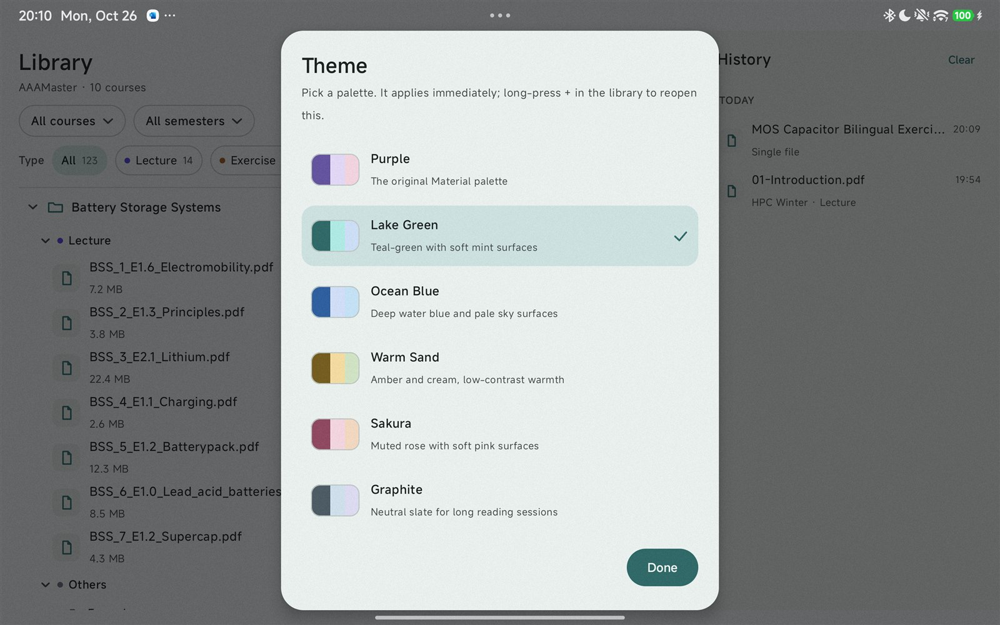
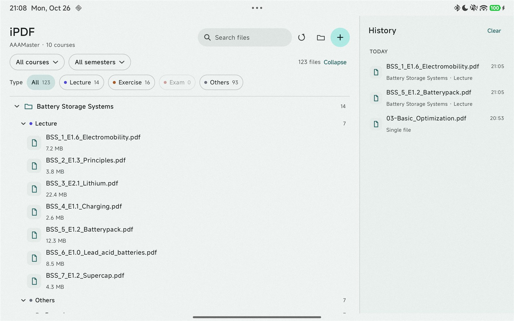
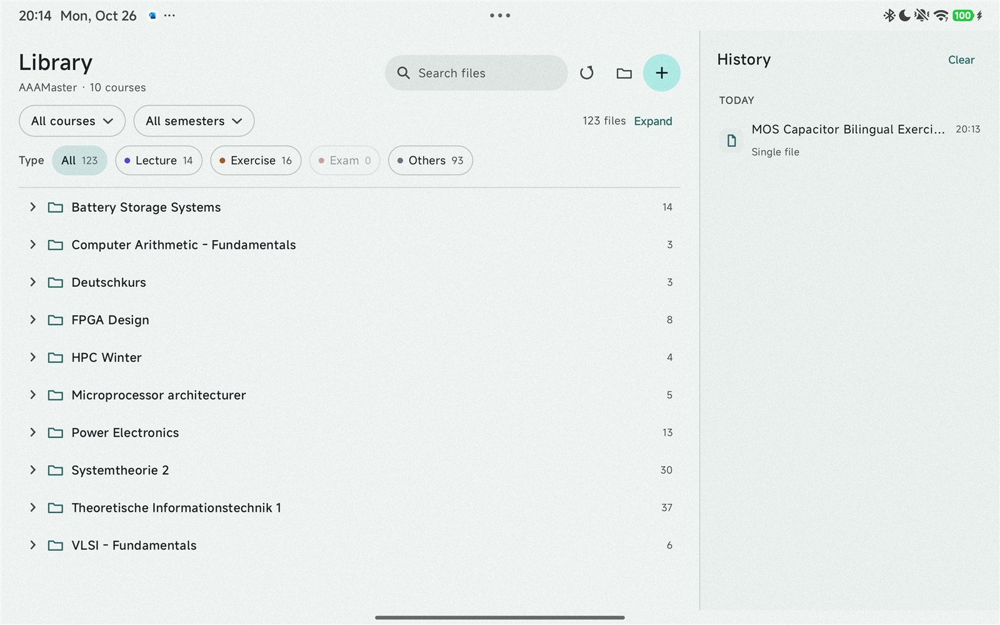
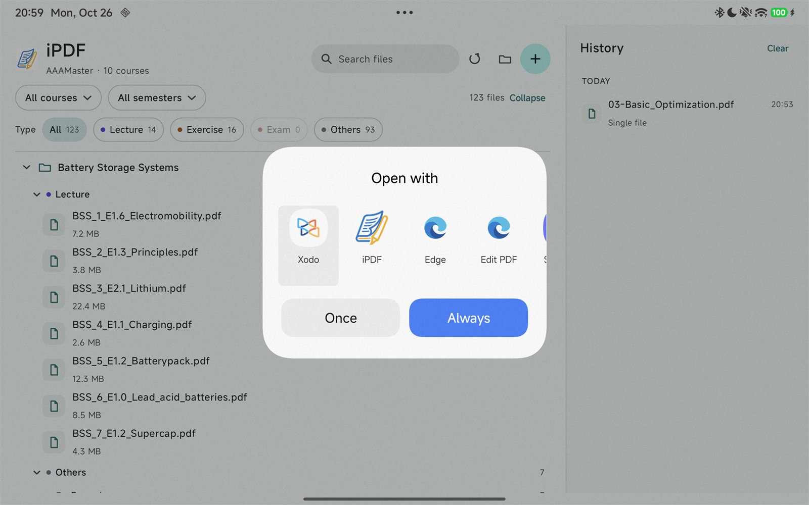
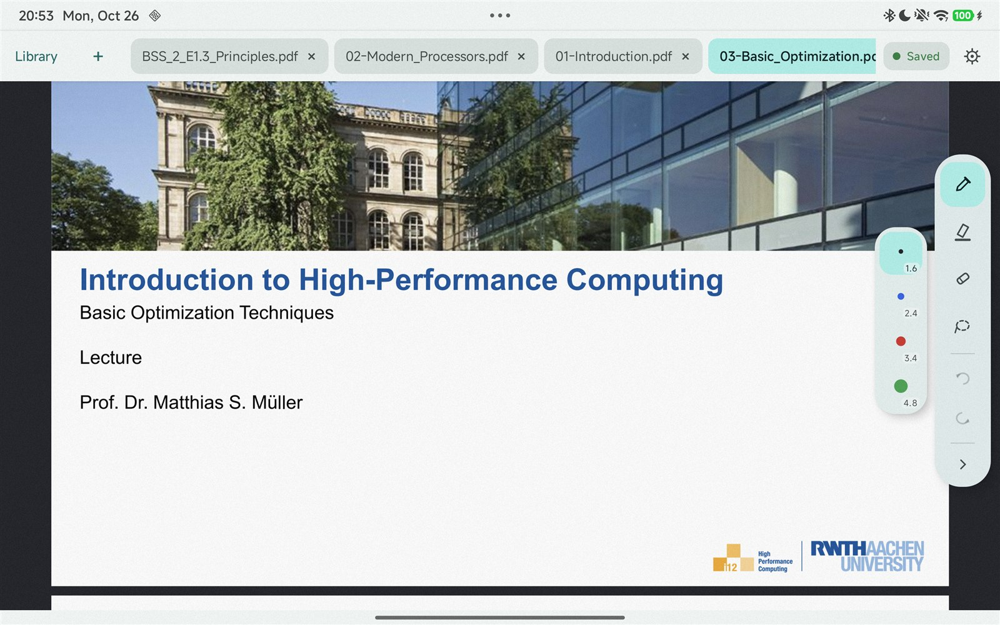
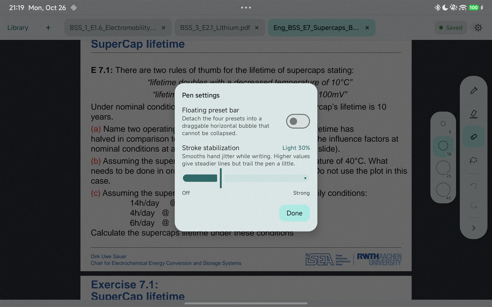
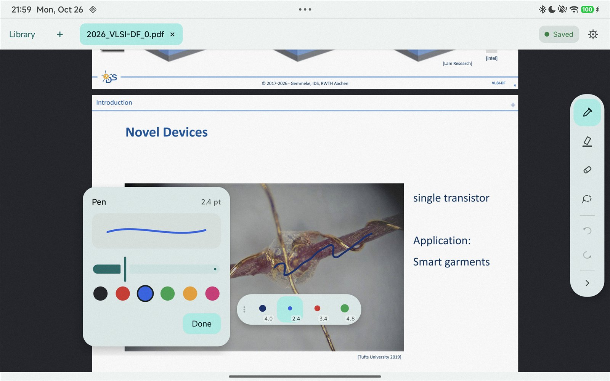

# Library 页面设计：文件夹树 + 四类筛选

> 状态：**已实现（首版 + 主题/默认打开 + iPDF 品牌 + 动效 + 笔迹稳定 + 存储权限）**。应用名 **iPDF**，包名 **`com.doge.ipdf`**；启动图标由整张 `logo.jpg`（不裁剪）经 `tools/generate-icons.ps1` 生成，Library 标题只用文字 wordmark（不再放图标）。代码在 `LibraryModel.kt` / `LibraryScanner.kt` / `LibraryStore.kt` / `LibraryViewModel.kt` / `LibraryScreen.kt` / `LibraryIcons.kt` / `AppTheme.kt`，`MainActivity.kt` 已接入。Debug APK 已安装到 Redmi K Pad 2；真实 `AAAMaster`（123 份 PDF）导入、树/筛选/历史/打开、Lake Green 主题、一键收起/展开、以及系统默认 PDF 打开都已在真机验证；旧包 `com.example.redmipdf` 已卸载。
>
> 视觉原型：[`mockups/library.html`](mockups/library.html)（浏览器打开，可用 `?state=default|filtered|menu|empty` 单看某个状态）
>
> 截图：[默认](screenshots/library-default.png) · [组合筛选](screenshots/library-filtered.png) · [课程下拉](screenshots/library-menu.png) · [首次使用](screenshots/library-empty.png)
>
> 原型按**改名后的目标结构**绘制（`Lecture` / `Exercise` / `Exam` / `Others` 四个精确名字）；当前 `AAAMaster` 里的 `Lecture Slides`、`Excercise`、`Exam (Information)` 等要先按 5.3 的对照表改名，未改名的二级文件夹会进 Others，但不会丢文件。

---

## 1. 目标与原则

1. 一级目录 = 课程文件夹；学期写成**前缀或后缀**（`26ws-HPC`、`Power Electronics-27ss`），不再额外加一层学期目录。
2. 课程内部固定分 **Lecture / Exercise / Exam / Others** 四类；类别只由**二级文件夹**（课程下的一级子目录）决定，识别不了就归 Others。类别下更深层的子文件夹保留为可折叠层级，但不再改变类别。
3. 三个筛选组（课程、类型、学期）可以 **任意组合**：只选一个、选两个或三个都选；不选 = 全部。组与组之间是 AND，同组内单选。
4. 左大右小两栏：左侧按**文件夹树**展示（课程 → 类别 → 原始二级文件夹 → 子文件夹 → PDF），右侧是历史记录。
5. 只缓存索引，不复制 PDF；打开仍走 content URI，Ink 仍写回原文件。

---

## 2. 布局

### 2.1 基准尺寸

以 K Pad 2 横屏约 **1000 × 634 dp** 为基准（实际宽度会略大，布局按比例自适应）。

| 区域 | 尺寸 |
| --- | --- |
| 左栏 | 剩余宽度（1000dp 下约 700dp） |
| 右栏 | 固定 300dp（`0.30 × 宽`，夹在 276–340dp） |
| 左栏内边距 | 左右 20dp，顶部 16dp |
| 标题行 | 58dp |
| 筛选行 1（课程 / 学期） | 44dp |
| 筛选行 2（类型） | 40dp |
| 分隔线 | 1dp，上方 9dp |
| 课程文件夹行 | 40dp |
| 类别行（可折叠） | 32dp |
| 原始二级文件夹 / 子文件夹行（可折叠） | 28dp |
| PDF 行 | 48dp |
| 右栏内边距 | 左右 12dp，顶部 14dp |

高度预算（634dp）：`16 + 58 + 44 + 40 + 10 = 168`，列表剩 **466dp**。

### 2.2 线框

```
┌────────────────────────────── 1000 dp ────────────────────────────────┬───────────────┐
│ Library                                    [ Search files ]  ⟳  ⌂  + │ History  Clear │
│ AAAMasters · 10 courses                                                │               │
│ [All courses ▾]  [All semesters ▾]             123 files  Collapse    │ TODAY         │
│ Type  [All 123] [● Lecture 29] [● Exercise 56] [● Exam 2] [● Others 36]│ ▤ 01-Intro 18:42│
│ ─────────────────────────────────────────────────────────────────────── │   HPC · Lecture│
│ ▾ 📁 26ws-HPC                                                     4    │               │
│    ▾ ● Lecture                                                    1    │ YESTERDAY     │
│        ▾ 📁 Chapter 1                                             1    │ ▤ FPGA Lab…   │
│            ▤ 01-Introduction.pdf            2.8 MB                     │   FPGA · Others│
│    ▾ ● Exercise                                                   1    │               │
│        ▤ HPC_Exercise_01.pdf                1.1 MB                     │               │
│    ▾ ● Exam                                                       1    │               │
│        ▤ HPC_Exam_2025.pdf                  0.8 MB                     │               │
│    ▾ ● Others                                                     1    │               │
│        ▾ 📁 Organization                                          1    │               │
│            ▤ 00-Organization.pdf            0.7 MB                     │               │
│ ▾ 📁 Power Electronics-27ss                                        13   │               │
│    ▾ ● Lecture                                                    4    │               │
│        ▾ 📁 Lecture Slides                                        4    │               │
│ …                                                                       │               │
└─────────────────────────────────────────────────────────────────────────┴───────────────┘
```

### 2.3 响应式

| 条件 | 行为 |
| --- | --- |
| 宽 ≥ 840dp | 两栏；右栏 `(宽 × 0.30)` 夹在 276–340dp |
| 宽 < 840dp | 单栏；历史收进 ModalBottomSheet；搜索折叠成图标；筛选行可横向滚动 |
| 竖屏 | 按窄屏处理 |
| 字体放大 | 行高随 `sp` 撑开，树滚动 |

---

## 3. 左栏

### 3.1 标题行

- 标题 `iPDF` 23sp / SemiBold，纯文字 wordmark；左上角不再放 logo 图标。
- 副标题 11.5sp：`AAAMasters · 10 courses`。
- 搜索框 196 × 38dp：匹配文件名、课程文件夹名、基名、类别、二级/子文件夹名、学期；不搜 PDF 正文。命中时展开到对应路径。
- 刷新：重扫当前文件夹，扫描中变成进度圈，保留旧树。
- 文件夹：重选根目录。
- `+`：打开单个 PDF，与文件夹无关。
- 结果数量放在筛选行 1 右侧：`123 files` / `4 of 123`。

### 3.2 筛选栏（A + B + C）

| 组 | 控件 | 选项 | 说明 |
| --- | --- | --- | --- |
| A 课程 | 胶囊 + 下拉菜单 | `All courses` + 每门课的**基名** | 菜单右侧显示数量；选中项打勾；多学期时基名只出现一次，数量合并 |
| B 类型 | 5 个 chip | `All` / `Lecture` / `Exercise` / `Exam` / `Others` | 始终可见，一键切换；chip 上带当前条件下的数量 |
| C 学期 | 胶囊 + 下拉菜单 | `All semesters` + 每个学期 + `Unassigned` | 归一化后显示 `26ws` / `27ss`；新→旧排序；`Unassigned` 最后 |

**组合规则**

- 三组都各自**单选**；任意两组或三组可以同时生效；全部不选 = 全部文件。
- 组间 AND：`课程 AND 类型 AND 学期 AND 搜索词`。
- 例如：只选 `HPC` → 这门课的全部文件；`Power Electronics + Lecture` → 这门课的 Lecture；`HPC + Lecture + 26ws` → 三者同时满足。
- **同一组内不做多选**（不能同时选 HPC 和 Power Electronics，也不能 Lecture + Exercise），已确认。
- 生效的胶囊用 `primaryContainer`，生效的类型 chip 用 `secondaryContainer`；`Reset` 只在任一条件或搜索生效时出现，清空三组 + 搜索。
- 数量为 0 的类型 chip 置灰不可点；课程/学期菜单里的 0 项同样置灰。
- 结果数量右侧的 `Collapse` / `Expand` 是一键收起/展开：收起所有课程、类别、二级文件夹和子文件夹；全部收起后按钮变成 `Expand`。筛选/搜索变化时自动回到全展开。

**数量（facet count）怎么算**

每个选项右侧的数字 = 应用**除当前组以外**的所有条件后的文件数：

- 课程菜单：按当前类型 + 学期 + 搜索词计数；
- 类型 chip：按当前课程 + 学期 + 搜索词计数；
- 学期菜单：按当前课程 + 类型 + 搜索词计数。

这样在选课程之前就能看到每门课在当前类型/学期下有多少份；选完课程后，类型 chip 会变成这门课的四类分布。

### 3.3 文件夹树

**层级**

```
课程文件夹（原始名字，可折叠）
└── 类别（Lecture / Exercise / Exam / Others，可折叠）
    ├── 原始二级文件夹（名字与类别不同时显示，可折叠）
    │   └── 子文件夹（可折叠）
    │       └── PDF
    └── PDF（直接放在类别目录下时）
```

- **二级文件夹是唯一的分类单位**：只有名字正好是 `Lecture` / `Exercise` / `Exam` / `Others`（忽略大小写和首尾空格）才进入对应类别；其他名字（`Lecture Slides`、`Excercise`、`Exam (Information)`、`Homework`、`Materials`、`Organization`…）**一律 Others**，并在 Others 下保留原始文件夹节点。
- 如果二级文件夹的名字正好等于类别名，不再重复显示一层，子内容直接挂在类别下。例如 `Lecture/Chapter 1/x.pdf` 显示为 `Lecture → Chapter 1 → x.pdf`。
- 把非标准名字改成四个标准名后重新扫描，它就会直接挂到对应类别；文件不需要移动（内容仍可在各自子文件夹里）。
- Others 下可以并列多个原始文件夹（`Materials`、`Organization`、`Homework`…），互不混淆。
- 课程根目录的 PDF 归 Others，直接列在 Others 类别下。
- 更深的子文件夹不再参与分类，只是树的一层；全部可折叠。
- 课程行 40dp，类别行 32dp，二级/子文件夹行 28dp，PDF 行 48dp。
- 课程行：折叠箭头 + 文件夹图标 + 原始文件夹名 + 数量。
- 类别行：折叠箭头 + 颜色点 + 类别名 + 数量。
- 文件夹行：折叠箭头 + 小文件夹图标 + 原始名字 + 数量。
- PDF 行：文件图标 + 文件名 13sp/600 + 副行 11sp（只有文件大小；路径已经在树里）。
- 排序：类别固定 Lecture → Exercise → Exam → Others；二级文件夹和子文件夹按名字 A→Z；文件按自然排序；文件夹先于文件。
- 所有文件夹层级**默认展开**，点行折叠/展开，状态在本次会话内保留；筛选/搜索时命中的分支自动展开，但用户仍可再折叠。

**筛选后的树**

- 课程、类别、二级文件夹、子文件夹、PDF 都按条件裁剪；没有命中的节点隐藏，但命中节点的祖先保留。
- 每个文件夹行右侧数量 = 它下面命中的 PDF 数。
- 筛选后**不摊平**：仍然保留完整的可折叠层级。例如 `Power Electronics + Lecture` 下仍然是 `Lecture → PLECS Simulation Models → PLECSExamples.pdf`。
- 选中课程筛选时只显示该课程并自动展开；搜索命中的路径自动展开。
- 如果类型已选，树里只出现该类别（例如选 Lecture 后每门课只剩 Lecture 段）。

### 3.4 状态

| 状态 | 左栏 |
| --- | --- |
| 未导入 | 空态卡片：目录结构示例 + `Choose folder` + `Open a PDF` |
| 扫描中 | 顶部细进度条 / 刷新图标转圈；旧树保留 |
| 没有 PDF | 提示 + `Rescan` / `Change folder` |
| 筛选无结果 | `No PDFs match these filters` + `Reset` |
| 文件夹权限丢失 | banner `Folder access was lost` + `Re-select`；历史仍可用 |
| 根目录直接放了 PDF | 扫描跳过，提示跳过数量 |

### 3.5 导入

1. `OpenDocumentTree` 选择根目录。
2. `takePersistableUriPermission(READ | WRITE)`（写权限是 Ink 写回 PDF 的前提；失败则只读提示）。
3. 扫描并建立索引，写入 `filesDir/library/index.json`。
4. 下次启动先读缓存，超过 24h 后台刷新；手动刷新随时可用。

---

## 4. 右栏：History

- 300dp，`surfaceContainerLow` 背景，左侧 1dp 分隔；与左栏形成主/次层级。
- 标题 `History` + `Clear`；按 `Today / Yesterday / Earlier` 分组；时间今天/昨天 `HH:mm`，更早 `MMM d`。
- 行：26dp 图标 + 文件名（单行省略）+ 右上角时间 + 副行 `课程基名 · 类别`；无法从索引解析时 `Single file`。
- 点击打开并置顶；长按菜单 `Open` / `Remove from history`；Clear 立即清空 + Snackbar 撤销。
- 上限 40 条，按 URI 去重；关闭标签页不删历史；清空历史不关标签页。
- 历史是全局的，不受左侧筛选影响。
- 窄屏收进 ModalBottomSheet（60% 高）。

> 历史按 content URI 存。**重命名课程文件夹会改变本地 SAF documentId**，旧历史项和阅读位置会失联（PDF 里的 Ink 仍能读回）。建议在正式阅读前把学期前缀/后缀定好。

---

## 5. 目录解析

### 5.1 目录结构

```
AAAMasters/                          ← 导入的根目录
├── 26ws-HPC/                        ← 课程文件夹（前缀学期）
│   ├── Lecture/                     ← 二级：识别为 Lecture
│   │   ├── 01-Introduction.pdf
│   │   └── Chapter 2/…              ← 更深层：继承 Lecture
│   ├── Exercise/                    ← 二级：Exercise
│   │   └── Homework/…               ← 三级：继承 Exercise
│   ├── Exam/                        ← 二级：Exam
│   └── Organization/                ← 二级无法识别 → Others（原始名字保留）
├── Power Electronics-27ss/          ← 课程文件夹（后缀学期）
│   ├── Lecture/                     ← 二级：精确匹配
│   │   └── PLECS Simulation Models/…← 更深层：继承 Lecture
│   └── Exercise/
└── Deutschkurs/                     ← 没有学期 → Unassigned
    └── Vokabelliste.pdf             ← 课程根下的 PDF → Others
```

- 根目录的直接子目录 = 课程；根目录直接放的 PDF 跳过（提示数量）。
- **只有二级文件夹**（课程的直接子目录）参与分类；更深层的文件夹全部继承二级的类别，不再改变。
- 二级文件夹名字**不是**四个标准名之一 → Others；它的原始名字保留在 Others 类别下，不丢信息。
- 标准类别名下直接展开（不再多一层同名节点）；Others 下可以并列多个原始文件夹（`Materials`、`Organization`、`Homework`…）。
- 课程根目录的 PDF 归 Others，直接列在 Others 类别下。
- 递归深度上限 8；跳过隐藏目录、`Android`、`LOST.DIR`、`.thumbnails`、临时文件；只收 `application/pdf` 或 `.pdf`。

### 5.2 学期前缀 / 后缀

**支持的写法**：`26ws-HPC`、`HPC-26ws`、`26ws HPC`、`HPC 26ws`、`26ws_HPC`、`HPC_26ws`、`WS26-HPC`、`HPC-WS26`、`2026ws-HPC`。

```kotlin
private const val YEAR = """(?:\d{2}|\d{4})"""
private const val TERM = """(?:ws|ss)"""

val suffixYearTerm = Regex("""^(.+?)[\s_\-–—.]*($YEAR)\s*($TERM)$""", RegexOption.IGNORE_CASE)
val suffixTermYear = Regex("""^(.+?)[\s_\-–—.]*($TERM)\s*($YEAR)$""", RegexOption.IGNORE_CASE)
val prefixYearTerm = Regex("""^($YEAR)\s*($TERM)[\s_\-–—.]*(.+)$""", RegexOption.IGNORE_CASE)
val prefixTermYear = Regex("""^($TERM)\s*($YEAR)[\s_\-–—.]*(.+)$""", RegexOption.IGNORE_CASE)
```

按 `suffixYearTerm → suffixTermYear → prefixYearTerm → prefixTermYear` 的顺序尝试；命中后把剩下的部分 trim 掉分隔符作为课程基名。

| 文件夹名 | 基名 | 学期 |
| --- | --- | --- |
| `26ws-HPC` | HPC | `26ws` |
| `HPC-26ws` | HPC | `26ws` |
| `Power Electronics-27ss` | Power Electronics | `27ss` |
| `VLSI - Fundamentals WS26` | VLSI - Fundamentals | `26ws` |
| `2026ws-Systemtheorie 2` | Systemtheorie 2 | `26ws` |
| `Deutschkurs` | Deutschkurs | `Unassigned` |

- 归一化：年份取后两位 + `ws/ss` 小写；`WS26`、`2026ws` 都归一到 `26ws`，避免同一学期裂成两个 chip。
- 学期排序：年份降序；同一年 `ss` 在 `ws` 前（按开学时间，`27ss` 晚于 `26ws`）。
- 前缀和后缀同时出现（如 `26ws-HPC-27ss`）时后缀优先；正常情况不会这样命名。
- 风险：课程名本身以两位数字 + `ss` 结尾（如 `Analysis 26ss`）会被误判；命名时避免即可。

### 5.3 四类映射

只检查课程下的**二级文件夹名字**（课程的直接子目录），并只做**精确匹配**（忽略大小写和首尾空格）：

| 二级文件夹名 | 类别 |
| --- | --- |
| `Lecture` | Lecture |
| `Exercise` | Exercise |
| `Exam` | Exam |
| `Others` | Others |
| 其他任何名字 / 课程根 | Others（保留原始文件夹名） |

- **不做别名、不做关键词猜测**：`Lecture Slides`、`Excercise`、`Exam (Information)`、`Homework`、`Materials` 等在未改名时都会进 Others。
- 导入前按下面的对照表把文件夹名改好（或移动到正确类别下），再 Rescan：

| 现在的名字 | 建议改成 |
| --- | --- |
| `Lecture Slides` / `Lecture Material` | `Lecture` |
| `Excercise` / `Exercises` / `Exercises Tasks` | `Exercise` |
| `Exam (Information)` / `Old Exams` | `Exam` |
| `Homework` | 移到 `Exercise/Homework`（三级，自动继承 Exercise） |
| `Materials` / `Organization` / `Teaching Materials` / `Allgemeines` / `Archive` | `Others`（二级或三级都行） |
| 课程根 PDF | 不用移动，归 Others |

- 改名后重扫，目标分布（把 `Homework` 放到 `Exercise` 下）：**Lecture 29 / Exercise 56 / Exam 2 / Others 36**。
- 不改名也能导入：所有非标准二级文件夹都在 Others，原始名字保留，不会丢文件；之后改名重扫即可。

### 5.4 文件副行显示

树已经保留了完整路径，所以 PDF 副行只显示文件大小，不重复文件夹名：

| 相对路径（课程内） | 树里的位置 | 文件副行 |
| --- | --- | --- |
| `Lecture/01.pdf` | Lecture → 01.pdf | `2.8 MB` |
| `Lecture/Chapter 1/01.pdf` | Lecture → Chapter 1 → 01.pdf | `2.8 MB` |
| `Lecture/PLECS Simulation Models/x.pdf` | Lecture → PLECS Simulation Models → x.pdf | `0.4 MB` |
| `Materials/Datasheets/x.pdf` | Others → Materials → Datasheets → x.pdf | `2.2 MB` |
| `00-Organization.pdf`（课程根） | Others → 00-Organization.pdf | `0.7 MB` |

---

## 6. 数据与持久化

### 6.1 模型

```kotlin
enum class DocType { LECTURE, EXERCISE, EXAM, OTHERS }

data class LibraryEntry(
    val uri: String,
    val name: String,
    val course: String,          // 基名，去掉学期（用于筛选）
    val courseFolder: String,    // 一级目录原始名（用于分组/显示）
    val semester: String?,       // "26ws" / "27ss" / null = Unassigned
    val type: DocType,           // 由课程下的二级目录决定；未识别 → OTHERS
    val relativeFolder: String,  // 课程内相对路径，如 "Lecture/Chapter 1"；根目录为 ""
    val size: Long,
    val modified: Long,
)

data class LibraryIndex(
    val rootUri: String,
    val rootName: String,
    val scannedAt: Long,
    val entries: List<LibraryEntry>,
)

data class HistoryEntry(
    val uri: String,
    val name: String,
    val openedAt: Long,
)
```

筛选状态：

```kotlin
data class LibraryFilters(
    val course: String? = null,        // 基名；null = All
    val type: DocType? = null,         // null = All
    val semester: SemesterKey? = null, // null = All
    val query: String = "",
)

sealed interface SemesterKey {
    data object Unassigned : SemesterKey
    data class Named(val label: String) : SemesterKey  // "26ws"
}
```

- 课程菜单的选项按 `course` 基名去重；选中一个基名会包含所有学期/所有原始文件夹。
- 树按 `courseFolder`（原始名）分组，这样 `26ws-HPC` 和 `27ss-HPC` 是两个可区分的课程文件夹。
- 树的构建：把 `relativeFolder` 按 `/` 拆段；第一段是二级文件夹（类别来源），后面是子文件夹。类别节点由 `type` 生成；第一段名字与类别规范名（`Lecture`/`Exercise`/`Exam`/`Others`）不同，或 `type == OTHERS` 时，保留为二级文件夹节点；完全相同时直接从类别下展开，避免 `Lecture → Lecture` 的重复。
- 历史只存 `uri/name/openedAt`，类别/课程在渲染时从索引解析；索引里没有则显示 `Single file`。

### 6.2 存储

| 内容 | 位置 |
| --- | --- |
| 索引 | `filesDir/library/index.json` |
| 历史 | `filesDir/library/history.json`（上限 40） |
| 筛选/搜索 | `SavedStateHandle` + `SharedPreferences` |
| 根目录授权 | `ContentResolver.persistedUriPermissions` |

- 用现有 `org.json` 手写序列化；先写 `.tmp` 再 rename。
- 启动先读缓存立即出树，超过 24h 后台刷新。
- 123 条索引约 40KB，过滤、计数、排序全部内存完成。

### 6.3 扫描

```
OpenDocumentTree → takePersistableUriPermission(READ|WRITE)
  → root 的每个一级目录 = 课程
      → 解析 course / semester（前缀或后缀）
      → 遍历课程的每个二级目录
          → 若目录名映射到四类之一，节点类别 = 该类别
          → 否则节点类别 = Others（保留原始目录名）
          → 递归收集其下所有 .pdf（更深层继承节点类别）
      → 课程根下的 .pdf → Others
  → entries 写入 index.json
```

- 每个目录一次 `DocumentsContract` query，取 `DOCUMENT_ID / DISPLAY_NAME / MIME_TYPE / SIZE / LAST_MODIFIED`；不用 `DocumentFile` 逐项查。
- 每个 PDF 的 URI 用 `DocumentsContract.buildDocumentUriUsingTree` 生成，直接交给 `ReaderSession`。
- 扫描在 IO 线程，`ensureActive()` 可取消，每完成一个目录回调进度。
- 上限深度 8、条目 5000；刷新时保留旧索引直到新扫描成功。
- 权限丢失时不扫描，显示 banner。

### 6.4 打开与历史

- 点 PDF → `selectedUri = entry.uri` → 现有 `ReaderScreen`；同时记录历史。
- 点历史项 → 同样打开。
- 单文件选择器打开 → 也记录历史。
- 关闭标签页保留历史；清空历史不关标签页。
- 树授权带 WRITE 时子文档可写；provider 只读时阅读正常但保存走现有 `Save failed` 状态。

### 6.5 与现有代码衔接

- 私有 `LibraryScreen` 从 `MainActivity.kt` 移到 `LibraryScreen.kt`。
- `ReaderApp` 增加 `LibraryViewModel`（`AndroidViewModel`，依赖已有）。
- `tabs` 继续表示已打开标签页；历史另存。打开文件时两边都更新。
- 从 Reader 点 `Library` 回到本页时保留筛选、搜索、滚动和折叠状态。

---

## 7. 视觉

| Token | 值 |
| --- | --- |
| Primary / onPrimary | `#6750A4` / `#FFFFFF` |
| Primary container | `#EADDFF`，文字 `#21005D` |
| Surface（左栏） | `#FEF7FF` |
| Surface low（右栏） | `#F7F2FA` |
| Surface container（hover / 图标底） | `#F3EDF7` |
| Surface high（搜索框） | `#ECE6F0` |
| Outline variant | `#CAC4D0` |
| onSurface / onSurfaceVariant | `#1D1B20` / `#49454F` |
| Lecture | `#4F46E5` |
| Exercise | `#B45309` |
| Exam | `#B3261E` |
| Others | `#6B7280` |

- 字体：系统默认；标题 23sp SemiBold，课程名 13sp SemiBold，类别名 12sp SemiBold，文件夹名 11.5sp，文件名 13sp SemiBold，副行 11sp。
- 圆角：胶囊/类型 chip 999，文件行 10dp，图标底 8dp，菜单 14dp。
- 树的缩进：课程行下有 26dp 竖向引导线；类别缩进 10dp；每下一级再缩进 14dp，最多到第 8 层。
- 文案沿用现有 app 的英文；要中文化再集中到 `strings.xml`。

---

## 8. 实现拆分

| 文件 | 内容 | 实际（行） |
| --- | --- | --- |
| `LibraryModel.kt` | `DocType`、Entry/Index/History、学期前后缀解析、二级目录四类映射、递归树构建、过滤、facet count、自然排序、JSON | 487 |
| `LibraryScanner.kt` | SAF 递归、类别继承、进度、取消、权限检查 | 253 |
| `LibraryStore.kt` | 索引/历史读写、根目录授权、缓存时间 | 56 |
| `LibraryViewModel.kt` | UI state、加载/扫描/筛选/折叠/一键收起、打开回调 | 291 |
| `LibraryScreen.kt` | 两栏、Header、两行筛选、递归文件夹树、History、空态/错误态、主题入口、过渡动效 | 1540 |
| `LibraryIcons.kt` | 自绘箭头/文件夹/文件/搜索/刷新/加号/勾选/关闭/历史图标 | 269 |
| `AppTheme.kt` | 6 套配色、主题持久化、主题选择对话框 | 442 |
| `res/mipmap-*/ic_launcher.png` | 仅传统图标（不做自适应）：整张 `logo.jpg`（不裁剪）按 80% 画在圆角白底内，经 `tools/generate-icons.ps1` 生成 | — |
| `MainActivity.kt` | 移除旧 LibraryScreen，接 `OpenDocumentTree`、打开/历史/标签页、主题、`ACTION_VIEW` | ~120 行改动 |

步骤：

1. 解析层（学期前后缀 + 四类 + 分组/计数）+ 单元测试 — 完成（8 个测试通过）。
2. 扫描 + 索引缓存 + 权限 — 完成。
3. 两行筛选 + 文件夹树 UI — 完成（空态真机通过；有数据态待导入验证）。
4. 接真实索引、筛选、搜索、打开、历史 — 完成。
5. 设备验收 — 部分：APK 已安装，空态通过；导入/筛选/树/历史待改名并解锁后走一遍。

测试清单：

- [ ] 按 5.3 对照表改名后导入：10 门课 / 123 份 PDF；类型分布 `Lecture 29 / Exercise 56 / Exam 2 / Others 36`。
- [ ] 未改名直接导入：`Lecture Slides`、`Excercise`、`Exam (Information)`、`Materials`、`Homework` 都在 Others 下，原始目录名可见，文件数不丢。
- [ ] 把 `HPC Winter` 改名为 `26ws-HPC Winter`，把 `Power Electronics` 改名为 `Power Electronics-27ss` → 学期筛选出现 `26ws` / `27ss`，基名不变。
- [ ] `Power Electronics/Lecture/PLECS Simulation Models/PLECSExamples.pdf` 的树路径是 `Lecture → PLECS Simulation Models → PDF`；筛选 `Power Electronics + Lecture + 27ss` 之后这条层级仍在，可逐级折叠。
- [ ] `Computer Arithmetic/Homework` 在二级时归 Others；移到 `Exercise/Homework` 后归 Exercise。
- [ ] 课程 / 类别 / 二级文件夹 / 子文件夹都能折叠和展开；默认展开。
- [ ] A+B、A+B+C 组合；Reset 清空；数量与 facet count 一致。
- [ ] 搜索 `lithium` / `PLECS` / 课程名均能命中并展开到命中路径；无结果时 Reset。
- [ ] 打开、重启：索引/历史/筛选保留；折叠状态在本次会话内保留。
- [ ] 在 PDF 上写字保存 → 写回树授权下的原文件。
- [ ] 撤销文件夹权限 → banner；历史仍能打开已授权文件。
- [ ] 横竖屏、字体放大；首次扫描/缓存启动/筛选无可感卡顿。

---

## 9. 风险与待确认

1. **同组多选**：已确认不做。课程 / 类型 / 学期每组单选，组间任意组合。
2. **二级文件夹只做精确匹配**：必须是 `Lecture` / `Exercise` / `Exam` / `Others`（忽略大小写）；其他名字一律 Others，并保留原始目录名。你已经决定自己改名，所以代码里没有别名表；改名后重扫即可。如果以后想单独筛 Materials/Exam，需要扩展 `DocType`。
3. **课程文件夹显示**：树里显示原始文件夹名（`26ws-HPC`），筛选里显示基名（`HPC`）。如果更希望树里也显示 `HPC · 26ws`，可以改。
4. **重命名成本**：改课程文件夹名会改变 SAF URI，历史/阅读位置失联；Ink 已写入 PDF 不受影响。建议正式阅读前定好命名。
5. **冷启动落点**：现在启动会回到上次 PDF；Library 作为主页后是否改成先到 Library？
6. **默认展开**：所有层级默认展开，筛选/搜索时命中路径自动展开；用户可再折叠。如果希望默认只展开课程、类别收起，可以调。

---

## 10. 验收标准

- 横屏进入 Library：左栏两行筛选 + 文件夹树，右栏历史，比例约 70/30。
- 任选一组/两组/三组条件，树即时更新，副标题/结果数显示 `X of 123`，Reset 可见。
- 课程文件夹名中的 `26ws`（前缀或后缀）被正确解析，基名用于课程筛选，原始名用于树头。
- 二级文件夹只按精确名字决定类别；识别不了的二级文件夹进 Others，原始名字仍在树里可见。
- 筛选后树仍保留 `课程 → 类别 → 二级文件夹 → 子文件夹 → PDF` 的可折叠层级，不摊平；每层都能展开/收起。
- 类型 chip 上的数量 = 该课程/学期/搜索条件下对应类别的文件数；按 5.3 改名后的目标分布为 `Lecture 29 / Exercise 56 / Exam 2 / Others 36`。
- 从树打开 PDF 后，历史首条即该文件；返回 Library 时筛选和滚动位置不变。
- `Collapse` / `Expand` 一键收起/展开所有层级，筛选变化后回到全展开。
- 长按 `+` 能打开主题选择；切换后立即生效、重启保留；Lake Green 为默认推荐配色。
- 在文件管理器里选择本应用为默认 PDF 打开方式后，任意 PDF 的 `ACTION_VIEW` 都会进入阅读器并记录历史。

---

## 11. 主题与默认 PDF 打开（已实现）

### 11.1 主题

长按 Library 右上角的 `+` 打开主题对话框；点击配色立即生效并持久化（`theme_state.theme_id`），`Done` 关闭。主题同时作用于 Library、Reader 顶栏、笔工具栏、历史面板、Snackbar 和状态栏底色。

| id | 名称 | primary | primaryContainer | surface | 特点 |
| --- | --- | --- | --- | --- | --- |
| `purple` | Purple | `#6750A4` | `#EADDFF` | `#FEF7FF` | 原 Material 紫 |
| `lake_green` | **Lake Green** | `#006A67` | `#9FF2EA` | `#F4FBF9` | 湖绿/薄荷，长时间阅读推荐 |
| `ocean` | Ocean Blue | `#0B5FA5` | `#D3E4FF` | `#F8F9FF` | 深海蓝 + 浅天蓝 |
| `sand` | Warm Sand | `#7A5900` | `#FFDF9A` | `#FFF9EE` | 琥珀 + 奶油，低对比暖色 |
| `sakura` | Sakura | `#9C405E` | `#FFD9E3` | `#FFF8F8` | 玫瑰 + 淡粉 |
| `graphite` | Graphite | `#465A64` | `#CEE6F2` | `#F7F9FA` | 中性石板灰，冷静 |

- 每个主题都定义了完整的 `primary / secondary / tertiary / surface / surfaceContainer* / outline / error`，避免默认紫色调残留。
- 对话框宽度上限 520dp，每行是三色色板 + 名称 + 一句描述 + 选中勾；当前主题高亮。
- 选中主题后 `SideEffect` 把状态栏颜色设为 `scheme.surface`，与页面底色衔接；状态栏图标保持深色（所有主题都是浅色）。





### 11.2 一键收起 / 展开

- 结果数量右侧的 `Collapse` / `Expand` 是同一个按钮：当前不是全收起时显示 `Collapse`，点一下收起所有课程、类别、二级文件夹和子文件夹；全部收起后显示 `Expand`，点一下全部展开。
- 状态由 `LibraryUiState.allCollapsed` + `collapsedKeys` 驱动；`toggleAllCollapsed()` 收集树里所有文件夹 key。
- 单选/搜索/Reset 改变树时自动清空折叠集合，保持结果可见；手动展开某个课程后按钮自动变回 `Collapse`。



### 11.3 默认 PDF 打开

- `AndroidManifest.xml` 的 `MainActivity` 注册了一组标准 `ACTION_VIEW` filter：`application/pdf`（MIME filter 对 `content://` 和 `file://` URI 都生效）；`launchMode="singleTop"`。
- `onCreate` / `onNewIntent` 读取 `intent.data`，调用 `persistPermission`（read+write，失败降级 read-only），写入 `pendingOpen`；`ReaderApp` 的 `LaunchedEffect` 把 URI 作为新标签打开并记录历史。
- 真机验证：在系统文件管理器里点 PDF → “iPDF” → “总是”后，`cmd package resolve-activity -a VIEW -t application/pdf` 返回 `com.doge.ipdf/.MainActivity` 且 `isDefault=true`；之后从文件管理器直接打开 PDF 进入阅读器，不再弹选择器。
- Android 不允许应用自行强制设为默认；首次需要在系统“打开方式”里点“总是”。从 `adb shell am start` 直接发起的 intent 有时仍会走 resolver，这是 shell caller 的系统行为，文件管理器路径已验证正常。
- 如果文件管理器只授予读权限，阅读正常，但写回 Ink 可能失败，沿用现有保存状态提示。





## 12. 过渡动效（已实现）

- **Library ↔ Reader**：`MainActivity` 用 `AnimatedContent` 以「是否在阅读」为目标状态切换；打开文档时阅读器以 0.965 起始缩放淡入、Library 淡出；返回主页是**纯淡入淡出**，不带缩放或滑动的“镜头感”。时长 150–300ms，不阻塞点击；同一阅读状态下切换标签页不触发整屏转场。
- **Library 内部状态**：加载 / 扫描 / 空库 / 无 PDF / 列表五种 body 通过 `AnimatedContent` 淡入（220ms，0.99 起始缩放），扫描完成或重新选目录时不会闪白。
- **文件夹树**：`LazyColumn` 的每一行使用 `Modifier.animateItem()`，展开/收起课程、类别、子文件夹时行做弹簧式插入/移除/位移；`ChevronGlyph` 的展开角度用 `animateFloatAsState` 在 0° 与 -90° 间旋转 220ms。
- **筛选控件**：类型 chip 与课程/学期 pill 的容器色、文字色、边框色用 `animateColorAsState` 过渡 180–190ms；搜索框的清除按钮用 `AnimatedVisibility` 缩放淡入淡出。
- 所有动效都只用 Compose 的标准缓动（`tween` / 默认弹簧），没有额外的第三方依赖；动画时长跟随系统「动画时长缩放」，关闭系统动画时自动退化为瞬时切换。

## 13. 笔迹稳定（已实现）

- 阅读界面右上角齿轮 → **Pen settings** 里新增 `Stroke stabilization` 滑杆（Off → Strong，默认 Light 30%），通过 `PenSettings` 持久化，改完立刻生效。
- 算法在 `StrokeStabilizer.kt`：以**距离自适应追踪**代替固定低通。每个原始采样点按 `alpha = d / (d + R)` 把滤波点拉向笔尖，`R = strength² × 14dp × density`。小幅手抖（亚像素到几像素）几乎推不动滤波点，快速运笔时 `alpha → 1` 迅速跟上，因此不会像固定 EMA 那样整体拖尾。
- 滤波器工作在屏幕像素空间，缩放前后手感一致；`strength = 0` 时完全旁路，采样点原样进入笔迹。
- 抬笔时在 `finishPenGesture` 追加一个原始落点，笔迹终点与笔尖一致，不会因为滤波滞后而短一截；单点轻触仍然是圆点。
- 只作用于笔/荧光笔的实时笔迹（`appendPoint`），橡皮与套索不受影响。`StrokeStabilizerTest` 覆盖了关闭、抖动抑制、快速跟随、半径映射与重置。



## 14. 存储权限与 PDF 写回（已实现）

- `AndroidManifest.xml` 声明 `MANAGE_EXTERNAL_STORAGE`（以及 API ≤ 29 的 `WRITE_EXTERNAL_STORAGE`、API ≤ 32 的 `READ_EXTERNAL_STORAGE`）。
- 启动时若未授权，弹出 `StorageAccessDialog`：说明「从文件管理器打开的 PDF 只有只读授权，写回笔迹需要所有文件访问权限，且只会改你打开的这一个 PDF」，按钮进入系统「所有文件访问权限」页面（Android 10 走运行时权限）；用户点 Later 后本次启动不再打扰。
- `ReaderSession.writeToOriginal` 先尝试 content URI（`rwt`/`wt`）；失败且已获授权时，解析真实路径直接写：
  - `com.android.externalstorage.documents` 的 `primary:` / `home:` / 其他卷；
  - Downloads 的 `raw:` document id；
  - 文件管理器 provider 的 `/external_files/...`、`/storage/emulated/0/...`、`/sdcard/...` 路径（HyperOS 的 `com.android.fileexplorer.myprovider` 就属于这种）。
  写入用同目录临时文件 + rename，目标必须是已存在的普通文件，避免误建/误删；写完后触发 `MediaScannerConnection` 让文件管理器看到新大小和时间。
- `MainActivity.onResume` 检测到权限从无到有时调用 `ReaderSession.flushAll()`，之前失败的保存立即重试。
- 修复了恢复笔迹后卡在「Not saved」的问题：`prepare()` 判定 `needsExport` 时把 `dirty` 置位，导出不再因为没有新编辑而被 `exportNow` 提前跳过。
- 读取侧同样兜底：content URI 读不到时用真实路径打开 PDF；`stamp` 与显示名也有文件路径回退。

## 15. 无工具默认与首笔马克笔（已实现）

- `PenTool` 新增 `NONE`；`PenSettings.tool` 不再从 SharedPreferences 恢复，**每次启动、打开或切换到某个 PDF 时都是未选择工具**（`openDocument` / 切换标签 / 关闭标签时调用 `clearTool()`）。
- 未选择工具时，dock 不显示任何高亮，预设栏和浮动预设条自动收起；笔尖接触页面不做任何操作（笔尖橡皮端仍可擦除）。
- 每次打开/切换 PDF 后 `PdfPageView.attachSession()` 重新武装；第一次笔尖接触且当前为 `NONE` 时，同步切到 `PenTool.PEN` + 第一个钢笔预设（用户口中的“马克笔”），并把该预设直接写入 View，所以这一笔本身就是马克笔笔迹。
- 如果用户在首次接触前已经手动选了工具，则尊重该工具，只消耗这次自动切换机会。
- 再次点击 dock 中已选中的工具会取消选择（`PenSettings.toggleTool`），回到无工具状态；笔身按钮仍按原来的笔/橡皮逻辑切换。

## 16. 共享调色板（已实现）

- `PenSettings` 为钢笔和荧光笔各保存一组调色板（`penPalette` / `hlPalette`，默认 6 色，持久化），同一种笔的所有预设共用这一行色块。
- 长按色块打开 HSV 取色器；确认后 `replacePaletteColor(index, color)` 用新颜色**覆盖该位置**的色块，所有原本使用旧色块的预设一起更新，当前预设也切到新颜色。
- 点击色块把该颜色应用到当前正在编辑的预设；选中环按完整 ARGB（含透明度）匹配。
- 因此自定义颜色会留在调色板的固定位置并跨预设共享，而不是只挂在某一个预设上。


